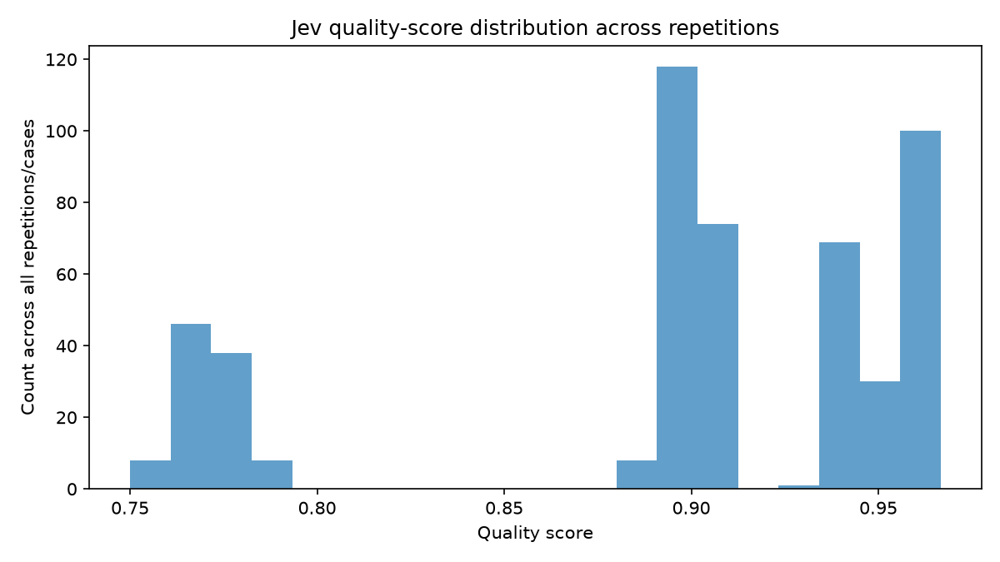
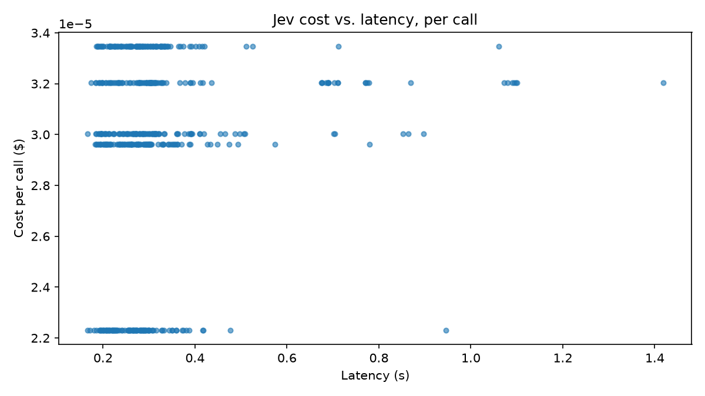

# Jev-as-Judge: Support-Ticket Agent Eval Report

Generated from 500 Jev judge calls across 5 frozen case(s), up to 100 repetition(s) per case.

`search_behavior` -> quality mapping: {'appropriate': 1.0, 'unnecessary': 0.5, 'failed': 0.0}. `does_pass` threshold: quality >= 0.5.

## Repeatability: quality-score variance per case

| ticket_id   |   n |   mean_quality |   variance |   ci_95_lo |   ci_95_hi |
|:------------|----:|---------------:|-----------:|-----------:|-----------:|
| t01         | 100 |         0.9631 |     0      |          0 |     0      |
| t06         | 100 |         0.9019 |     0      |          0 |     0      |
| t10         | 100 |         0.8984 |     0      |          0 |     0      |
| t17         | 100 |         0.9429 |     0      |          0 |     0      |
| t20         | 100 |         0.7713 |     0.0001 |          0 |     0.0001 |

## Binary variance: Bernoulli p(1-p) of does_pass, per case

| ticket_id   |   p_pass |   bernoulli_variance |
|:------------|---------:|---------------------:|
| t01         |        1 |                    0 |
| t06         |        1 |                    0 |
| t10         |        1 |                    0 |
| t17         |        1 |                    0 |
| t20         |        1 |                    0 |

## Cost and latency

|   n_calls |   mean_cost_per_call |   cost_per_1000_evals |   latency_p50_s |   latency_p95_s |
|----------:|---------------------:|----------------------:|----------------:|----------------:|
|       500 |                    0 |                0.0295 |          0.2802 |          0.6903 |

## Charts

## What this means

- **Small sample size.** This run covers 5 frozen case(s) repeated up to 100x for repeatability. These numbers are directional, not statistically definitive - treat any single-digit percentage-point movement as noise.

- **One call per ticket-evaluation.** Jev's `state` carries all evidence and answers all three typed questions (`groundedness`, `search_behavior`, `usefulness`) in a single `system_one.create()` call.

- **Repeatability is not correctness.** Low variance only means Jev gives a consistent score on the same input - a judge can be perfectly consistent and consistently wrong. This report does not measure agreement with human judgment; it only measures how stable Jev's own scores are across repeated calls.
